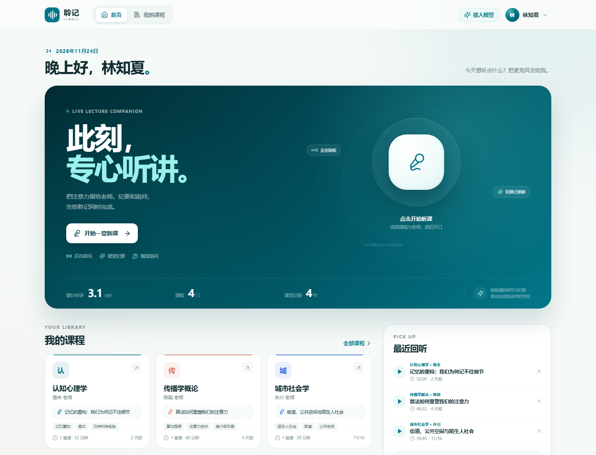
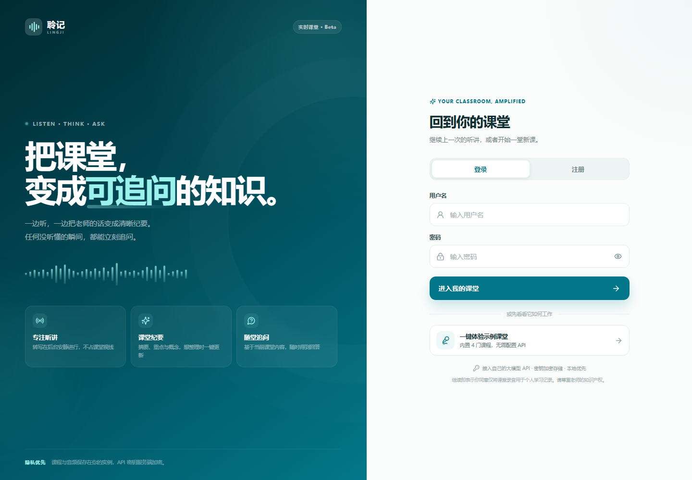
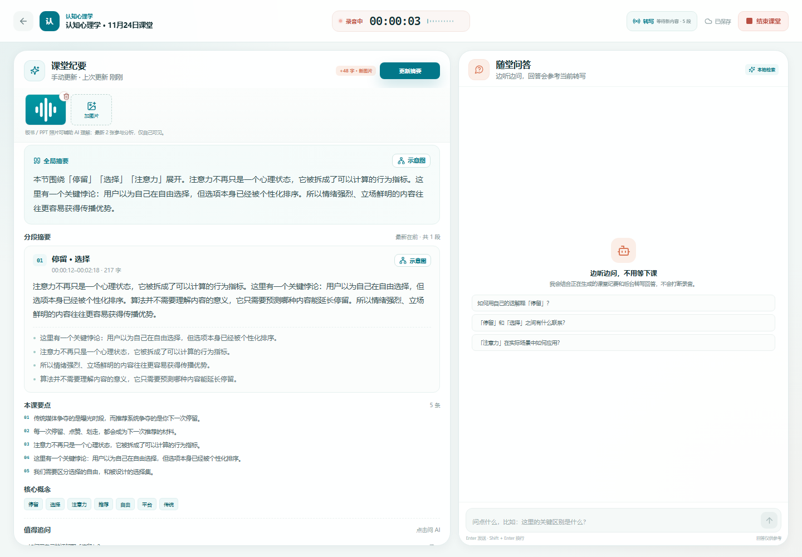
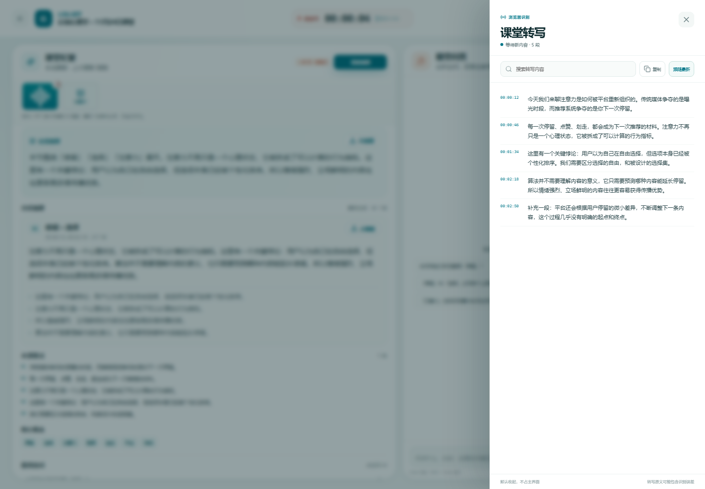
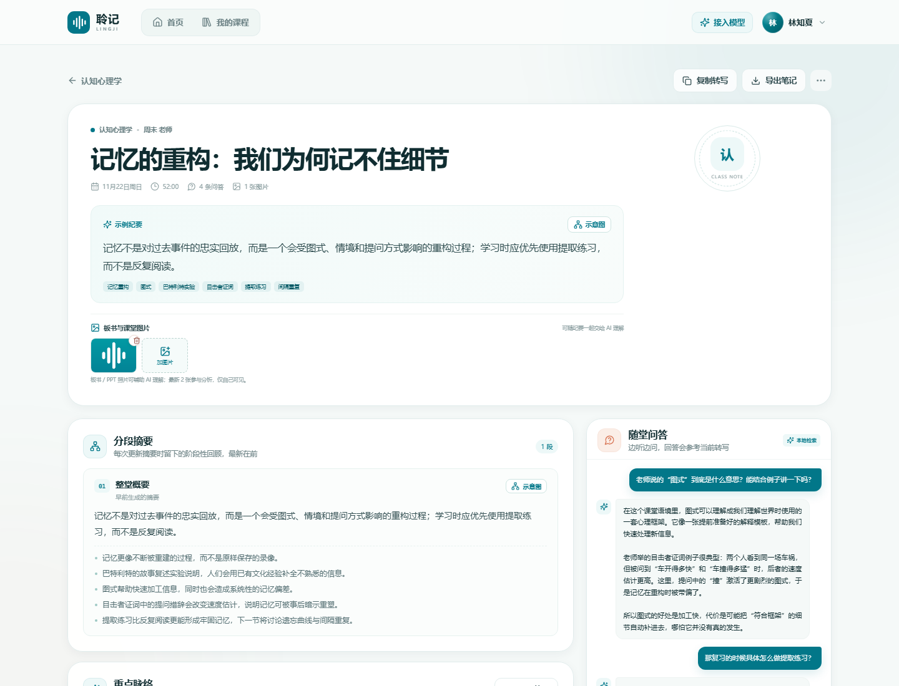
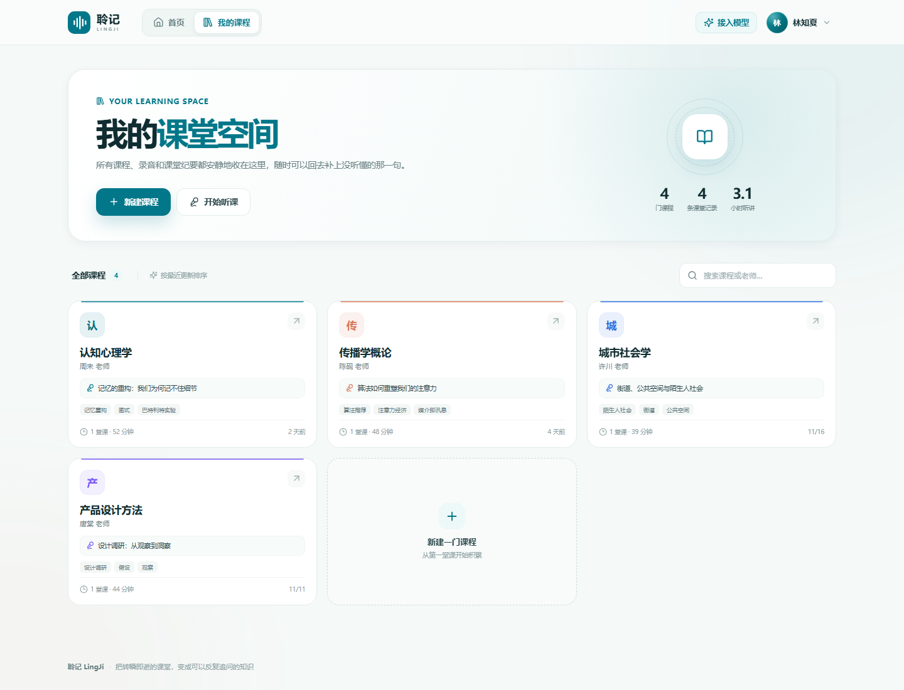
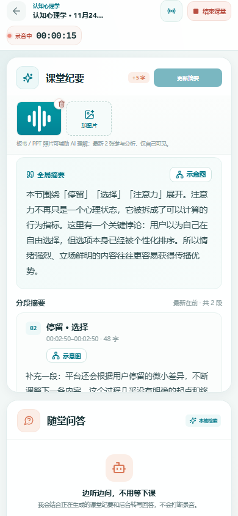
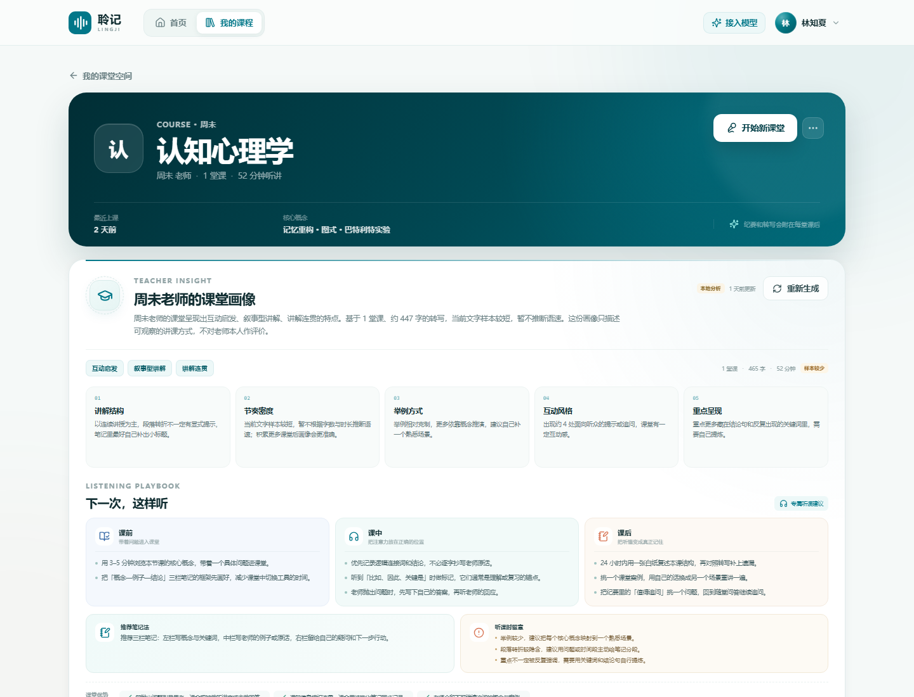
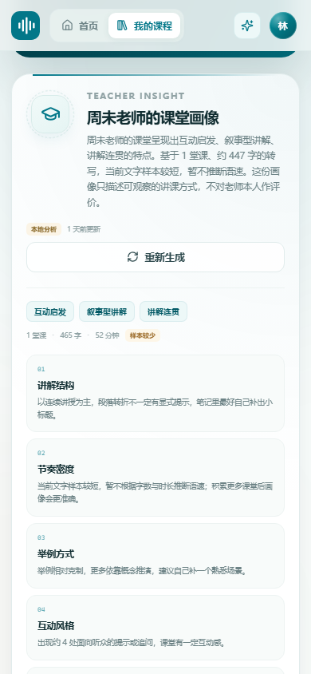

# 聆记 LingJi

> 把课堂，变成可以追问的知识。

一个面向课堂实时听讲的轻量 Web 应用：录音在后台转写，界面只保留手动更新的 AI 纪要和随堂问答；可以随时拉出转写抽屉回看，也可以上传板书 / PPT 图片辅助理解。支持登录注册、课程管理、个人空间、课堂录音回放、自定义大模型 API，以及基于多堂课生成的**老师讲课风格画像与专属听课建议**。



## 界面预览

| 登录 | 课堂纪要（手动更新） |
| --- | --- |
|  |  |

| 转写抽屉 | 课堂回顾 |
| --- | --- |
|  |  |

| 个人空间 | 手机端课堂 |
| --- | --- |
|  |  |

| 老师画像与听课建议 | 手机端课堂画像 |
| --- | --- |
|  |  |

| 新版本提醒（版本号仅作示例） | 更新详情 |
| --- | --- |
|  |  |

## 为什么选这个方案

| 决策 | 原因 |
| --- | --- |
| **Web 应用而不是桌面端** | 无需安装、跨设备打开；麦克风与流式转写在 Chrome / Edge 中已经足够成熟 |
| **浏览器 Web Speech API 做后台转写** | 不额外消耗用户的语音识别额度，不用上传整段音频；界面只展示纪要，减少干扰 |
| **录音用 MediaRecorder 单独保存** | 转写与录音解耦：语音识别失败时录音仍在，可以之后回听 |
| **OpenAI 兼容接口 + 服务端代理** | DeepSeek、OpenAI、通义千问、Moonshot、Ollama 等都能接；密钥不会被浏览器读取，也绕开 CORS |
| **无 API 也能工作** | 本地抽取式纪要和课堂原文检索，注册后立即可用；接入模型后再升级为推理式纪要 |
| **JSON 单文件存储** | 小范围个人使用零运维；数据在 `.data/db.json`，便于备份与迁移 |

课堂纪要的刷新策略：**完全手动**。录音过程中，只有点击右上角「更新摘要」才会请求模型；按钮会显示「+N 字」「新图片」等待处理内容。没有点击时，模型接口零请求。

服务端维护一份**全局浓缩摘要**：每次只把「上一版摘要 + 上次摘要之后的新增转写」发给模型，输出限制为 120 字摘要和最多 5 条短要点，`max_tokens` 为 420；板书图片只在新上传时发送一次，不随每次摘要重复计费。

## 功能

- 用户名注册 / 登录 / 会话保持
- 首页麦克风入口：选择已有课程或新建课程与老师，开始课堂
- 后台转写：不占用主界面，状态栏可见；可随时拉出转写抽屉
- 外部 ASR：可选接入 OpenAI 兼容的 `/audio/transcriptions`，绕开浏览器语音云的网络问题
- 课堂纪要：手动点击「更新摘要」，只处理新增内容，显示未摘要字数与新图片
- 随堂问答：流式回答，基于当前转写、纪要和课堂图片，支持中断
- 图片辅助：上传板书 / PPT / 教材照片，随纪要和问答一起交给支持视觉的模型
- 课堂计时：刷新页面后从上次累计时间继续，不清零
- 自带 API：DeepSeek / OpenAI / 通义千问 / Moonshot / 任意 OpenAI 兼容接口
- 老师画像：基于本课程多堂课，生成风格标签、讲解结构、节奏、举例、互动、重点呈现
- 听课建议：课前 / 课中 / 课后策略、专属笔记法、需要留意的难点与画像证据
- 个人空间：列出全部课程、课堂数量、累计时长、最近课堂
- 课堂回顾：完整纪要、转写、问答历史、课堂图片、音频回放、Markdown 导出
- 录音归档与删除；课程级联删除
- 响应式 UI，主色 `#027789`
- Windows 便携 exe / 安装程序：双击安装或启动，自动创建快捷方式，不需要安装 Node.js
- 可选更新通知：登录后静默检查新版本，浮层提醒；不打断正在进行的课堂

## 快速开始

要求：Node.js **20.19+**（已在 Node 24 验证）、pnpm（推荐）或 npm。

```bash
pnpm install
pnpm dev
```

打开 <http://127.0.0.1:4173>。

`pnpm dev` 第一次启动时会创建演示账号：

```text
用户名：demo
密码：demo1234
```

也可以直接点击登录页的「一键体验示例课堂」，内置 4 门课程、课堂纪要与老师画像。

生产模式：

```bash
pnpm build
pnpm start
```

生产模式默认**不会**创建 demo 账号。只有显式设置 `SEED_DEMO=true` 才会在全新数据目录中创建它。公开部署请保持 `SEED_DEMO=false`。

### Windows 便携 exe

在 Windows 上构建（需要 Node.js 22+，最终用户不需要 Node）：

```bash
pnpm desktop:build
```

生成：

```text
release/LingJi.exe
release/使用说明.txt
```

如果目标电脑会拦截未签名 exe，可以再生成免管理员便携版：

```bash
pnpm desktop:portable
```

生成 `release/LingJi-Portable-NoAdmin/`，内部使用 Node.js 官方签名运行时和 `启动聆记.cmd` / `Start-LingJi.cmd` 启动。

`LingJi.exe` 是自包含的便携程序，接收者不需要安装 Node.js。双击后会：

1. 在本机启动服务（默认 `127.0.0.1:4173`，被占用时自动顺延）；
2. 优先用 Edge / Chrome 的独立应用窗口打开界面；
3. 数据默认保存在 `%LOCALAPPDATA%\LingJi`；该目录不可写时会自动回退到用户目录、程序目录或临时目录；
4. 再次双击会复用已运行的实例，不会重复启动。

exe 采用「本地服务 + 系统浏览器」而不是 Electron 外壳，原因是 Electron 内置的 Chromium 通常无法使用浏览器语音识别（`SpeechRecognition` 会返回 network error）。使用 Edge / Chrome 打开可以保留完整的后台转写能力。

发布包没有做代码签名，Windows SmartScreen 可能显示“未知发布者”。构建产物在 `release/`，已在 `.gitignore` 中排除。

### Windows 安装程序（推荐分享）

如果只想发一个文件给别人，用安装程序：

```bash
pnpm installer:all
```

生成：

```text
release/LingJi-Setup-1.2.0.exe   约 22 MB
```

它按**当前用户**安装，不需要管理员权限：

- 安装目录：`%LOCALAPPDATA%\Programs\LingJi`
- 自动创建桌面快捷方式「聆记 LingJi」和开始菜单项
- 开始菜单里包含卸载入口，也会出现在 Windows「应用和功能」中
- 安装完成可直接启动
- 卸载时询问是否保留课堂数据，默认保留
- 安装的是免管理员便携版的 payload，使用官方签名 Node 运行时

安装程序的 Windows 清单是 `asInvoker`，正常不会弹 UAC。它本身仍未做代码签名，所以 SmartScreen 可能提示“未知发布者”；确认来源后选择“仍要运行”即可，不需要管理员。

构建安装程序需要 NSIS。项目默认从 `build/nsis/makensis.exe` 读取编译器；可下载 NSIS 3.11 并解压到 `build/nsis`。完整重新构建：

```bash
pnpm installer:all
```

当前 `release/` 中也保留了可直接分发的 zip：

```text
release/LingJi-Windows-x64.zip         单文件 exe 版
release/LingJi-Portable-NoAdmin.zip    免管理员便携版（推荐给受限电脑）
release/LingJi-Setup-1.2.0.exe         安装程序（推荐普通用户）
release/SHA256SUMS.txt
```

`LingJi.exe` 约 84 MB；两个 zip 都约 33 MB，安装程序约 22 MB，适合通过网盘或聊天工具传播。

### 更新通知与更新入口

登录后会静默检查一次更新，之后每 6 小时检查一次；只有发现新版本时，才在右下角显示一个可关闭的浮层。录音页不显示更新提示，不会打断课堂；检查失败也不会影响任何功能。

设置页底部新增「关于与更新」，可以手动检查。点击「下载更新」下载新安装包，关闭旧窗口后运行即可，课程、录音、图片和 API 设置都会保留。

更新通道需要你在构建时指定一个公网 HTTPS 清单地址：

```powershell
$env:UPDATE_MANIFEST_URL = "https://your-domain.com/updates/latest.json"
pnpm installer:all
```

详细的上传、生成清单和回滚流程见 **[updates/README.md](updates/README.md)**。

> **重要：已经发出去的 1.0.0 没有更新检查代码，无法自动收到通知。** 第一次需要手动发送 1.2.0 安装包。1.2.0 安装包必须用真实的 `UPDATE_MANIFEST_URL` 构建，后续版本才会自动提示；如果构建时没有配置更新地址，设置页会显示“尚未配置更新通道”，这版仍只能手动分发。

### 如果双击 exe 被要求管理员权限

`LingJi.exe` 的 Windows 清单已经是 `asInvoker`，正常情况下不需要管理员权限。如果某台电脑仍然要求管理员：

1. 确认是**解压后**运行，而不是直接在压缩包里双击；
2. 右键 exe → 属性 → 常规 → 勾选「解除锁定」；
3. 右键 exe → 属性 → 兼容性 → 取消「以管理员身份运行此程序」；
4. 仍然被拦时，使用免管理员便携版。

免管理员便携版不依赖自包含 exe，而是使用 **Node.js 官方签名的 node.exe** 运行应用：

```text
release/LingJi-Portable-NoAdmin.zip
  LingJi-Portable-NoAdmin/
    node.exe                 官方 Node.js 22，带有效数字签名
    app.mjs                  应用服务端
    dist/                    前端资源
    启动聆记.cmd             双击这个文件
    Start-LingJi.cmd         ASCII 文件名备用启动器
    使用说明.txt
```

解压后双击 `启动聆记.cmd`（或 `Start-LingJi.cmd`）即可。它同样会自动打开 Edge/Chrome，首次注册账号。这条路线通常能绕过针对未签名单文件 exe 的 SmartScreen / 安全策略。

如果使用官方签名的 Node 运行时仍然被拦截，说明电脑启用了 Smart App Control、AppLocker 或杀毒软件白名单，应用自身无法绕过；需要管理员放行，或为发布者购买代码签名证书。

exe 和网页版使用不同的数据目录。如果想把当前网页版的数据迁移到 exe：

1. 退出正在运行的 LingJi.exe；
2. 把网页版 `.data/` 中的 `db.json`、`audio/`、`secret` 复制到 `%LOCALAPPDATA%\LingJi`；
3. 再启动 exe。

`secret` 必须一起复制，否则已保存的 API Key 无法解密。也可以设置 `LINGJI_DATA_DIR`，让 exe 直接使用一个指定目录。

### 常见安装问题

如果 pnpm 拦截了 esbuild 的安装脚本：

```bash
pnpm approve-builds --all
pnpm install
```

项目已附带 `pnpm-workspace.yaml` 允许 esbuild 构建。

## 接入自己的 API

进入右上角「接入模型」，选择服务商或填写任意 OpenAI Chat Completions 兼容接口：

```text
API 地址：https://api.deepseek.com/v1
模型名称：deepseek-chat
API Key：sk-...
```

支持示例：

- DeepSeek：`https://api.deepseek.com/v1` / `deepseek-chat`
- OpenAI：`https://api.openai.com/v1` / `gpt-4o-mini`
- 通义千问：`https://dashscope.aliyuncs.com/compatible-mode/v1` / `qwen-plus`
- Moonshot：`https://api.moonshot.cn/v1` / `moonshot-v1-8k`
- 本地 Ollama：`http://127.0.0.1:11434/v1` / 自己拉取的模型名

API Key 使用 AES-256-GCM 加密后存在本机，浏览器只能看到“已保存”和尾号。点击「测试连接」会用当前表单先保存、再发出一次极小的真实模型请求。

不填 API Key 时，仍然可以使用：

- 本地课堂纪要（抽取式摘要 + 关键词 + 追问建议）
- 基于课堂转写的本地问答检索
- 录音、转写、课程与回顾的全部功能

## 浏览器与麦克风

- 推荐 **Chrome / Edge**（Web Speech 后台转写支持最完整）。
- 麦克风需要安全上下文：`http://127.0.0.1` / `http://localhost` 或 HTTPS。
- 浏览器语音识别一般需要联网；网络中断时录音和计时继续，识别器会在后台自动重连。
- 第一次点击开始后，请允许麦克风权限。
- 课堂内容较长时，建议把设备放在靠近讲台的位置，或使用外接麦克风。

### 浏览器识别网络中断怎么办

Web Speech 使用的是 Chrome/Edge 厂商的语音云，应用无法更换它的网络通道；在国内网络下常见 `network` 中断。设置页新增了可选的「服务端语音识别」：

- 填写 OpenAI 兼容的 `baseUrl`、`model`、`apiKey`
- 开启后浏览器识别关闭，本地 Node 服务每 20 秒把一段完整音频分片发送到 `${baseUrl}/audio/transcriptions`
- 音频分片只在内存中转发，不写入 `.data`
- 不配置时仍然使用浏览器识别，原有用法不变
- 可接 Whisper、SenseVoice 或自建 faster-whisper 兼容服务；具体精度取决于供应商，不承诺与 iMA 完全相同

设置项保存后需要重新进入录音页生效。

## 数据与隐私

```text
.data/
  db.json       用户、会话、课程、转写、纪要、问答
  audio/        课堂录音文件
  images/       板书 / PPT 图片
  secret        用于加密 API Key 的本地密钥
```

- 录音、图片与课程数据保存在运行服务的机器上。
- 生成纪要或提问时，会把**课堂文字和用户上传的图片**发送到用户配置的模型服务；音频不会发给模型。
- 只有手动更新摘要时才发送「上一版浓缩摘要 + 新增转写」；图片只在新上传时发送，避免重复计费。
- 开启外部 ASR 后，20 秒音频分片会发送到你配置的转写服务；未开启时使用浏览器识别，音频不离开本机。
- 浏览器语音识别由浏览器自身处理，具体联网策略取决于浏览器。
- 备份时复制整个 `.data/` 目录即可。删除 `secret` 会导致已保存的 API Key 无法解密。
- 如果更换 `APP_SECRET`，同样会使旧密钥失效，需要重新填写 API Key。

## 环境变量

| 变量 | 默认值 | 说明 |
| --- | --- | --- |
| `PORT` | `4173` | 服务端口 |
| `HOST` | `127.0.0.1` | 监听地址；局域网访问设为 `0.0.0.0` |
| `APP_SECRET` | 自动生成 | API Key 加密主密钥，生产环境建议显式设置 |
| `COOKIE_SECURE` | `false` | HTTPS 部署时设为 `true` |
| `TRUST_PROXY` | `false` | 位于反向代理后时设为 `true` |
| `SEED_DEMO` | 仅开发模式 | 是否在全新数据目录创建 `demo/demo1234`；公开部署必须为 `false` |
| `DATA_DIR` | `./.data` | 可选的数据目录；Docker 中保持默认并挂载 `/app/.data` |
| `UPDATE_MANIFEST_URL` | 空 | 公网 HTTPS 更新清单地址；不设置则不检查更新。构建 exe 时也要设置同名变量 |

PowerShell 示例：

```powershell
$env:PORT="8080"
$env:HOST="0.0.0.0"
$env:APP_SECRET="请替换为至少 16 位的随机字符串"
$env:COOKIE_SECURE="true"
pnpm start
```

## 给别人使用 / 公开部署

项目已经附带：

- `Dockerfile` 与 `compose.yaml`
- `.env.example`
- `deploy/Caddyfile.example`（自动 HTTPS，推荐）
- `deploy/nginx.conf.example`

最简流程：

```bash
cp .env.example .env
# 设置 APP_SECRET、COOKIE_SECURE=true、TRUST_PROXY=true、SEED_DEMO=false
docker compose up -d --build
```

然后用 Caddy / Nginx 反向代理到 `127.0.0.1:4173` 并配置域名 HTTPS。完整的 VPS、Cloudflare Tunnel、Railway/Render、备份、恢复和上线检查清单见：

**[deploy/README.md](deploy/README.md)**

公开使用时请特别注意：HTTPS、`SEED_DEMO=false`、持久化 `.data/`、单实例运行。当前版本没有自助找回密码和邮箱验证，但管理员可以在停机后运行 `scripts/reset-password.mjs` 为用户生成随机新密码；`scripts/remove-demo.mjs` 可以清理演示账号。当前 JSON 单文件存储适合个人或小范围使用；如果要支持更多用户，建议迁移到 SQLite/PostgreSQL，并把音频放到对象存储。

## 技术结构

```text
src/
  pages/          登录、首页、空间、课程、录音、回顾、设置
  components/     导航、纪要、问答、图片附件、波形、课程卡片、弹窗
  hooks/          麦克风、MediaRecorder、SpeechRecognition 封装
  context/        登录态、全局 Toast、更新检查
  lib/            API 客户端、格式化
server/
  index.mjs       Express 路由与静态资源
  desktop.mjs     Windows 便携版入口：数据目录、端口、浏览器启动
  auth.mjs        scrypt 密码、会话、AES-256-GCM
  llm.mjs         OpenAI 兼容代理、流式回答、增量纪要 / 老师画像 JSON
  analyzer.mjs    本地纪要、老师画像、关键词抽取、本地问答
  updates.mjs     更新清单拉取、版本比较、缓存与静默失败
  images.mjs      图片元数据、模型上下文与清理
  store.mjs       串行化写入的 JSON 存储
  seed.mjs        演示账号、示例课程与初始老师画像
scripts/
  build-desktop.mjs   esbuild 单文件化 → pkg → 图标 / 版本信息
  build-portable.mjs  生成使用官方签名 Node 的免管理员便携版
  build-installer.mjs NSIS 编译安装程序并更新校验文件
  build-update-manifest.mjs 生成 latest.json（含 SHA256）
  smoke.mjs           登录 → 转写 → 增量纪要 → 问答 → 图片 → 归档 → 删除
  security-smoke.mjs  权限、密钥与课程生命周期
  ai-smoke.mjs        mock 模型验证增量摘要、图片输入与老师画像
  update-smoke.mjs    更新清单版本比较与解析
  remove-demo.mjs     停机后清理演示账号
  reset-password.mjs  停机后重置用户密码
  visual.mjs          无头浏览器截图（视觉验收用）
installer/
  LingJi.nsi      NSIS 安装脚本（按用户安装、快捷方式、卸载入口）
updates/
  README.md       更新通道部署、发布清单与旧版限制
  notes-1.2.0.md  1.2.0 更新说明
deploy/
  README.md       公开部署、HTTPS、备份与上线检查清单
  Caddyfile.example
  nginx.conf.example
Dockerfile / compose.yaml
build/icon.ico
```

### 接口概览

- `POST /api/auth/register|login|logout`、`GET /api/auth/me`
- `GET /api/dashboard`、`GET/POST /api/courses`
- `POST /api/courses/:id/teacher-profile`（老师画像 + 听课建议）
- `POST /api/lectures`、`GET/PATCH /api/lectures/:id`
- `PUT /api/lectures/:id/transcript`
- `POST /api/lectures/:id/notes`（增量摘要，只发送新增转写）
- `POST /api/lectures/:id/chat`（SSE 流式，可带图片上下文）
- `POST /api/lectures/:id/asr`（可选的 20 秒音频分片转发）
- `POST/GET/DELETE /api/lectures/:id/images`
- `POST/GET /api/lectures/:id/audio`
- `GET /api/update`（可选更新检查）
- `GET/PUT /api/settings`、`POST /api/settings/test`

## 测试

先启动服务，再运行：

```bash
node scripts/smoke.mjs
node scripts/security-smoke.mjs
node scripts/ai-smoke.mjs
node scripts/asr-smoke.mjs
node scripts/update-smoke.mjs
```

- `smoke.mjs`：登录、课程、转写同步、增量纪要、SSE 流式问答、图片上传、老师画像、录音上传、归档与删除
- `security-smoke.mjs`：未授权拦截、API Key 加密不回传、昵称修改与课程生命周期
- `ai-smoke.mjs`：mock 模型验证增量摘要只发送新增内容、`max_tokens=420`、图片 `image_url` 输入和老师画像（会临时改写 demo 的模型设置，要求当前未保存 API Key，结束后恢复）
- `asr-smoke.mjs`：mock `/audio/transcriptions`，验证 ASR 配置、密钥鉴权、20 秒分片转发和清理
- `update-smoke.mjs`：版本比较、清单解析和“有更新”判断

另有 `scripts/register-smoke.mjs` 用于验证注册流程，但它会创建一个临时账号，不建议在生产数据上运行。
`scripts/visual.mjs` 会调用本机 Edge 生成 `screenshots/` 下的页面截图，仅用于视觉验收。

## 设计说明

- 主色 `#027789`，搭配深青 `#013e47`、薄荷 `#8ae4df` 与少量暖橙，避免“医疗系统”感。
- 登录页用大面积深青与声音波形建立“正在听”的第一印象。
- 首页把麦克风做成整页的视觉中心；课程和最近回听作为第二层信息。
- 录音页只保留两块主内容：左侧课堂纪要（含板书图片），右侧随堂问答；转写在后台进行，点击顶部「转写」打开抽屉回看；移动端纵向堆叠。
- 课程页的老师画像用「画像标签 + 五个观察维度 + 课前/课中/课后 playbook」组织，避免把老师放进人格测评式的框架。
- 所有图标来自 `lucide-react`，没有外部图片依赖，离线也能完整显示。

## 已知边界

- 浏览器 Web Speech 识别质量受口音、噪声和网络影响；可在设置里接入 OpenAI 兼容的外部 ASR（Whisper、SenseVoice 等）绕开浏览器语音云，并提升准确率。
- 当前 JSON 存储非多实例安全；不适合大规模多租户部署。
- 没有邮箱验证与自助找回密码；管理员重置需要停服务并使用脚本，具体见 [deploy/README.md](deploy/README.md)。
- Windows exe 使用系统 Edge/Chrome 承载界面，会保留一个本地服务窗口；关闭该窗口即停止服务。exe 未做代码签名，首次运行可能出现 SmartScreen 提示。
- 便携 exe 默认仍使用浏览器识别；开启外部 ASR 后，由本地 Node 服务每 20 秒转发音频分片到你配置的转写接口，录音和计时不受识别失败影响。
- 图片辅助分析需要模型支持视觉（如 `gpt-4o-mini`、`qwen-vl-plus`）；不支持时会自动回退文字分析，图片仍保留在课堂里。
- 音频按整段在录音结束后上传；超长课堂或网络中断时可能需要重试。
- 纪要与问答均由模型生成，复习时请以课堂原始转写和老师讲解为准。
- 老师画像是基于有限课堂样本的听课辅助，只描述可观察的讲课方式，不评价老师本人；样本较少时会标注“样本较少”，积累更多课堂后再更新会更准确。

---

如果这个项目对你有帮助，把它留在你的本地课堂里就好。请尊重老师的知识产权，录音仅用于个人学习记录。
