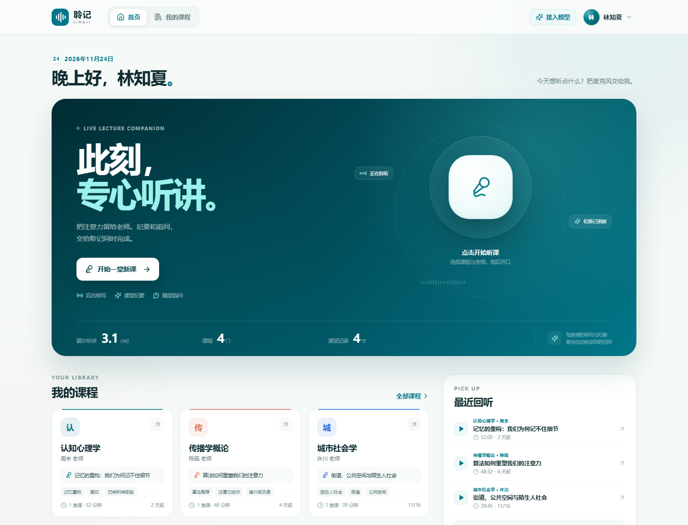
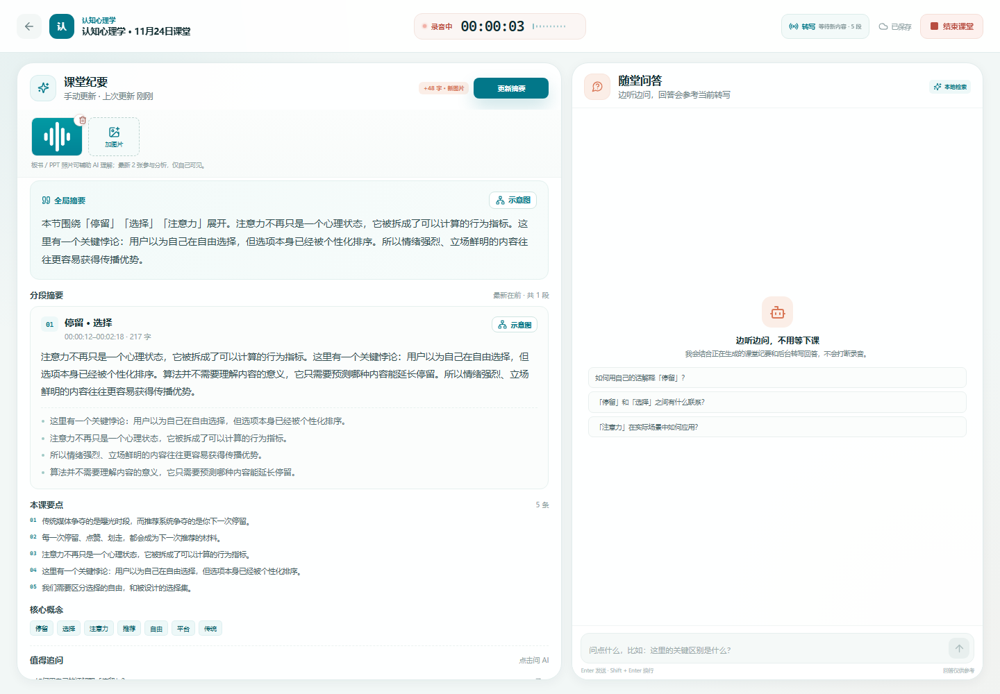
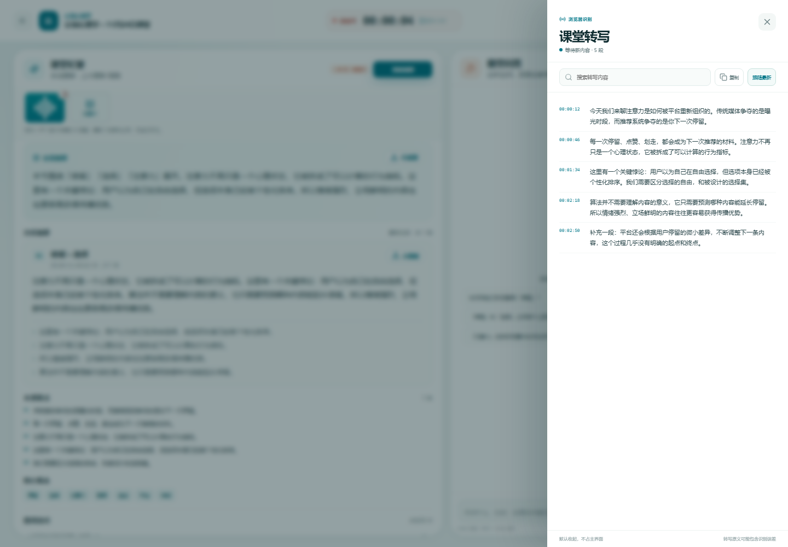
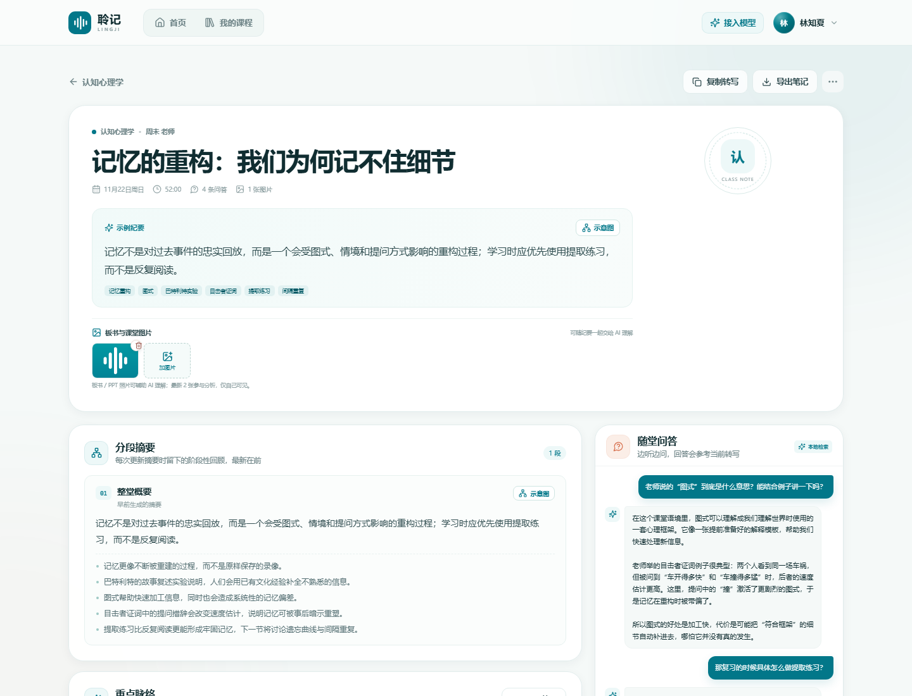
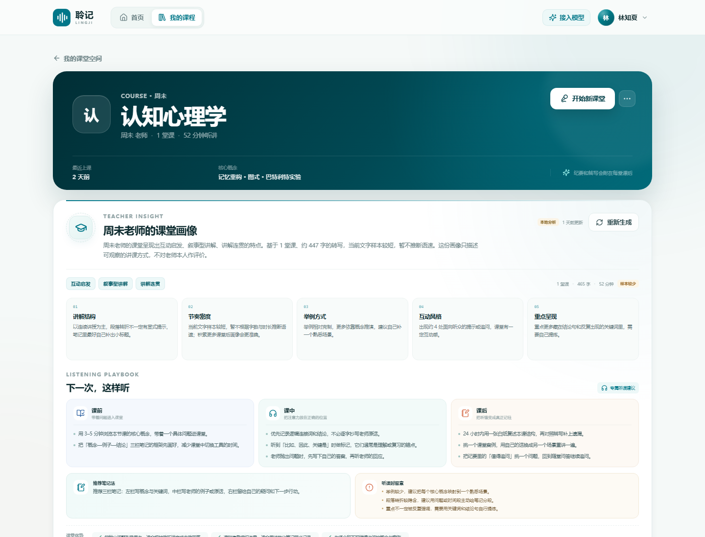
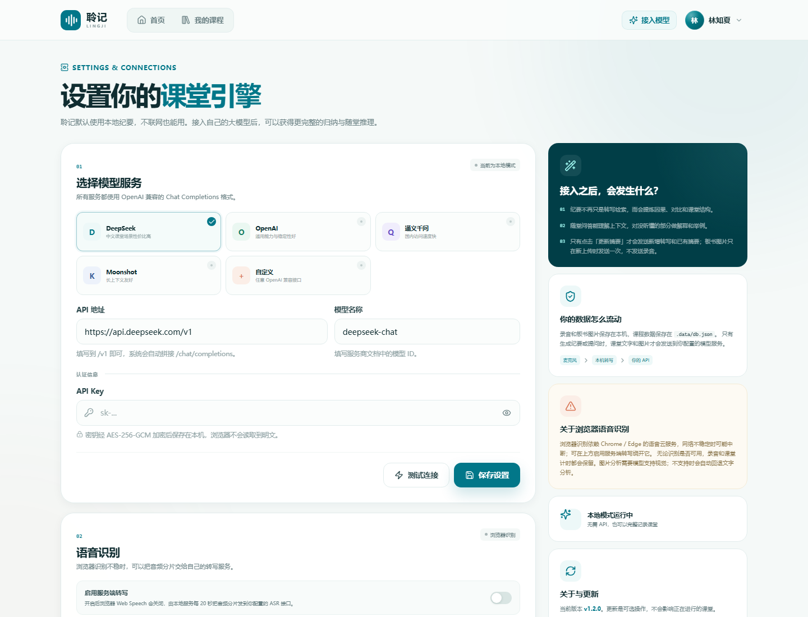

# 第一章 认识聆记

## 1.1 聆记是什么

聆记（LingJi）是一个面向课堂实时听讲的轻量工具。它把「录音、转写、课堂纪要、随堂问答」放进同一个页面：录音和转写在后台安静进行，主界面只保留一份可以随时刷新的课堂纪要，以及一个能就当前内容追问的问答框。

它适合这样的场景：

- 上课时不想一边听一边疯狂记笔记，但希望下课后有一份能看懂的结构化记录。
- 老师讲得快、例子多，当堂没跟上的地方，想立刻问一句「这里是什么意思」。
- 一学期下来有很多门课，希望按课程归档，复习时能回听录音、检索原文、继续追问。
- 不希望课堂录音和笔记散落在各种云端笔记里，希望数据留在自己的电脑上。

聆记的核心取舍是**手动更新纪要**：录音过程中模型不会自动反复调用，只有你点击「更新摘要」时，才会把「上一版摘要 + 这之后的新增转写」发给模型。这样既控制了费用，也避免纪要频繁跳动打断你听课。

## 1.2 核心能力一览

| 能力 | 说明 | 是否依赖外部 API |
| --- | --- | --- |
| 课堂录音与计时 | 浏览器麦克风录音，刷新页面后计时从上次继续 | 否 |
| 后台转写 | 默认使用浏览器语音识别；也可改用自己的服务端转写 | 默认否，服务端转写时是 |
| 课堂纪要 | 摘要、要点、核心概念、值得追问的问题，手动更新 | 否（无 API 时用本地抽取式纪要） |
| 随堂问答 | 基于当前转写、纪要和板书图片回答，支持流式输出与中断 | 否（无 API 时用本地检索） |
| 板书 / PPT 图片 | 最多 6 张，随纪要与问答交给支持视觉的模型 | 图片分析需要视觉模型 |
| 课堂回顾 | 完整纪要、逐段转写、问答历史、录音回放、Markdown 导出 | 否 |
| 老师画像 | 基于多堂课提炼讲课风格与专属听课建议 | 否（无 API 时用本地画像） |
| 课程与空间 | 课程归档、搜索、统计、级联删除 | 否 |
| 版本更新 | 登录后静默检查，可选下载新版本 | 否 |

## 1.3 三种使用形态

| 形态 | 适合谁 | 启动方式 | 数据默认位置 |
| --- | --- | --- | --- |
| Windows 安装版 | 大多数 Windows 用户，只想双击使用 | 桌面快捷方式「聆记 LingJi」 | `%LOCALAPPDATA%\LingJi` |
| 免管理员便携版 | 公司或学校电脑限制了安装、拦截未签名 exe | 解压后双击 `启动聆记.cmd` | `%LOCALAPPDATA%\LingJi` |
| 网页版 / 自部署 | 想改代码、部署到服务器、多人访问 | `pnpm dev` 或 `pnpm start` | 项目下的 `.data/` |

三种形态的界面和功能一致，区别只在启动方式与数据目录。安装版和便携版内部仍然是「本地服务 + 系统浏览器」：程序在本机启动一个服务，再用 Edge 或 Chrome 的独立窗口打开界面，因此可以完整使用浏览器的语音识别能力。

**浏览器要求**：推荐最新版 Chrome 或 Edge。麦克风需要安全上下文，即 `http://127.0.0.1`、`http://localhost` 或 HTTPS 地址；用局域网 IP 的 http 地址打开时，浏览器可能拒绝授予麦克风权限。

## 1.4 界面地图

| 页面 | 入口 | 主要用途 |
| --- | --- | --- |
| 登录 / 注册 | 首次打开 | 创建账户、登录、一键体验示例课堂 |
| 首页 | 顶部导航「首页」 | 开始新课堂、继续未结束的课堂、查看统计与最近回听 |
| 我的课程 | 顶部导航「我的课程」 | 全部课程、搜索、新建课程 |
| 课程详情 | 点击任一课程卡片 | 老师画像、课堂记录列表、开始新课堂 |
| 录音页 | 首页麦克风 / 课程页「开始新课堂」 | 录音、计时、转写抽屉、课堂纪要、随堂问答、板书图片 |
| 课堂回顾 | 点击已结束的课堂 | 纪要、完整转写、问答、录音回放、导出、删除 |
| 设置 | 右上角「接入模型」或账号菜单 | 大模型 API、服务端转写、昵称、更新检查 |



## 1.5 开始前需要准备什么

1. 一台可以正常上网的电脑，安装 Chrome 或 Edge。
2. 可用的麦克风。笔记本内置麦克风可用；坐得靠后时，建议用耳机麦克风或外接麦克风。
3. 可选：一个大模型 API Key。没有也能完整使用录音、转写、本地纪要和本地问答。
4. 可选：一个 OpenAI 兼容的语音转写服务地址与密钥。只有在你决定启用「服务端转写」时才需要。

# 第二章 安装、启动与登录

## 2.1 使用安装程序（推荐）

如果你拿到的是 `LingJi-Setup-1.2.0.exe`：

1. 双击安装包。Windows SmartScreen 可能提示「未知发布者」，点击「更多信息」→「仍要运行」。
2. 安装程序按**当前用户**安装，不需要管理员权限，正常不会弹 UAC。
3. 安装目录为 `%LOCALAPPDATA%\Programs\LingJi`，会自动创建桌面快捷方式「聆记 LingJi」和开始菜单项。
4. 安装完成后可直接启动。开始菜单和 Windows「应用和功能」里都有卸载入口。

卸载时会询问是否保留课堂数据，默认保留。需要彻底清理时，请在卸载后再手动删除数据目录。

## 2.2 使用免管理员便携版

如果电脑禁止安装软件，或对未签名的单文件 exe 拦截较严，使用 `LingJi-Portable-NoAdmin.zip`：

1. 解压到任意可写目录（不要直接在压缩包里双击）。
2. 双击 `启动聆记.cmd`，或 ASCII 文件名的 `Start-LingJi.cmd`。
3. 程序使用官方签名的 `node.exe` 运行，通常会绕过针对未签名 exe 的 SmartScreen 提示。

目录内包含 `node.exe`、`app.mjs`、`dist/` 和启动脚本。请保持这些文件在同一目录，不要只把启动脚本单独复制出去。

## 2.3 网页版与自部署（简述）

适合开发、改造或部署到服务器的用户。需要 Node.js 20.19 及以上版本。

```bash
pnpm install
pnpm dev          # 开发模式，默认 http://127.0.0.1:4173
pnpm build
pnpm start        # 生产模式
```

也可以使用仓库自带的 Docker 配置：

```bash
cp .env.example .env
# 至少填写 APP_SECRET，公开部署时 COOKIE_SECURE=true、TRUST_PROXY=true、SEED_DEMO=false
docker compose up -d --build
```

常用环境变量：

| 变量 | 默认值 | 说明 |
| --- | --- | --- |
| `PORT` | `4173` | 服务端口 |
| `HOST` | `127.0.0.1` | 监听地址；局域网访问设为 `0.0.0.0` |
| `APP_SECRET` | 自动生成 | API Key 的加密主密钥，生产环境建议显式设置 |
| `COOKIE_SECURE` | `false` | HTTPS 部署时设为 `true` |
| `TRUST_PROXY` | `false` | 位于反向代理后时设为 `true` |
| `SEED_DEMO` | 仅开发模式 | 是否在全新数据目录创建 `demo/demo1234`，公开部署必须为 `false` |
| `DATA_DIR` | `./.data` | 自定义数据目录 |

完整的域名、HTTPS、备份与上线检查清单见 `deploy/README.md`。

## 2.4 第一次打开

双击快捷方式后，程序会做三件事：

1. 在本机启动服务，默认使用 `127.0.0.1:4173`；端口被占用时自动顺延。
2. 优先用 Edge / Chrome 的独立应用窗口打开界面。
3. 在 `%LOCALAPPDATA%\LingJi` 建立数据目录；该目录不可写时自动回退到用户目录、程序目录或临时目录。

再次双击快捷方式会复用已经运行的实例，不会重复启动服务。关闭那个服务窗口，本地服务就会停止。

## 2.5 注册、登录与示例账号

首次使用需要注册一个本地账户：

1. 在登录页切换到「注册」。
2. 填写「怎么称呼你」（昵称，可留空，默认与用户名相同）、「用户名」、「密码」。
3. 密码至少 6 位。点击「创建账户并开始」。

已有账户时直接在「登录」页输入用户名和密码。登录状态会保持 30 天，除非你主动退出或清除浏览器 Cookie。

开发模式（`pnpm dev`）第一次启动会创建演示账号：

```text
用户名：demo
密码：demo1234
```

登录页还会出现「一键体验示例课堂」按钮，内置 4 门课程、课堂纪要与老师画像，无需配置 API。生产模式默认不会创建演示账号；只有显式设置 `SEED_DEMO=true` 才会创建。

## 2.6 启动与登录常见问题

| 现象 | 原因 | 处理方式 |
| --- | --- | --- |
| SmartScreen 提示「未知发布者」 | 安装包未做代码签名 | 确认来源后点「更多信息」→「仍要运行」 |
| 双击 exe 提示需要管理员 | 在压缩包内直接运行，或兼容性设置残留 | 解压后运行；属性 → 兼容性 → 取消「以管理员身份运行」 |
| 双击后没有窗口 | 端口被占用或浏览器未启动 | 等待几秒；检查是否已有实例；换用 Edge / Chrome 打开提示的地址 |
| 提示数据目录不可写 | 程序目录只读或受管控 | 允许写 `%LOCALAPPDATA%`，或设置 `LINGJI_DATA_DIR` 指向可写目录 |
| 页面能打开但录音按钮无反应 | 浏览器不支持麦克风 API | 换最新版 Chrome / Edge，并确认地址是 127.0.0.1 或 HTTPS |
| 忘记密码 | 当前版本没有自助找回 | 管理员停止服务后运行重置脚本，见 7.11 |

# 第三章 基础功能

## 3.1 开始一堂课

1. 在首页点击麦克风圆钮，或「开始一堂新课」。
2. 在弹窗中选择一门已有课程；也可以直接填写「课程名称」和「老师名字」新建一门课。
3. 点击「开始听课」。浏览器会请求麦克风权限，请选择「允许」。
4. 页面跳转到录音页，约半秒后自动开始录音，顶部显示「录音中」和计时。
5. 顶部状态会显示麦克风波形、录音时长和转写状态。计时在刷新页面后从上次累计时间继续。

小提示：

- 开始前程序会先申请一次麦克风权限，避免进入课堂后才发现没有声音。
- 如果自动开始被浏览器拦截，页面会显示「重新连接」按钮，点击即可重试。
- 课程名称和老师名字会显示在录音页、课堂回顾和老师画像里，建议第一次就填完整。

## 3.2 录音页导览



| 区域 | 内容与作用 |
| --- | --- |
| 顶部左侧 | 返回首页、课程标记、课程名与课堂标题 |
| 顶部中间 | 录音状态、计时、实时波形 |
| 顶部「转写」 | 打开转写抽屉，显示识别状态与已识别段数 |
| 顶部保存状态 | 「已保存」「保存中」「待重试」 |
| 顶部「结束课堂」 | 结束并归档这堂课 |
| 左侧「课堂纪要」 | 摘要、要点、核心概念、值得追问的问题，以及板书图片 |
| 左侧「更新摘要」 | 手动把新增转写和图片整理进纪要 |
| 右侧「随堂问答」 | 就当前课堂内容提问，回答流式输出 |
| 移动端 | 自动纵向堆叠，先纪要、后问答 |

## 3.3 后台转写与转写抽屉

转写不占用主界面，状态只在顶部「转写」按钮上简要显示：准备识别、正在识别这一句、刚刚更新、等待新内容、识别中断等。点击按钮会从右侧拉出转写抽屉。



抽屉里可以：

- 用搜索框筛选包含关键词的段落。
- 点「复制」把全文复制到剪贴板。
- 在「跟随最新」和「自由浏览」之间切换。向上翻阅时自动进入自由浏览，不会把你拽回底部。
- 按 `Esc` 或点击遮罩关闭。

需要注意：

- 转写原文可能包含识别误差，人名、术语和数字尤其容易出错。
- 默认使用浏览器语音识别。它依赖 Chrome / Edge 的语音云服务，网络不稳时可能中断；中断时录音和计时不受影响，识别器会在后台尝试重连。
- 如果浏览器本身不支持 Web Speech，页面会提示「当前浏览器不支持后台语音识别」，录音和问答仍然可用，此时建议按第五章启用服务端转写。

## 3.4 课堂纪要（手动更新）

课堂纪要不是自动刷新的。录音过程中，只有点击右上角「更新摘要」才会请求模型。

按钮旁会显示待处理内容：

- `+N 字`：上次更新之后新增的转写字数。
- `新图片`：上传了尚未纳入纪要的板书图片。

没有待处理内容时按钮不可点。新增不足 20 字且没有新图片时，也不会触发更新，避免为几句话反复调用模型。

每次更新的处理方式：

1. 先把当前转写同步到服务端。
2. 只把「上一版浓缩摘要 + 上次摘要之后的新增转写」发给模型。
3. 模型输出一份不超过 120 字的全局摘要，以及最多 5 条短要点。
4. 板书图片只在新上传时发送一次，不随每次摘要重复计费。

界面上的来源标签会告诉你纪要来自哪里：「AI 分析」表示由你的模型生成，「本地分析」表示使用本地抽取式摘要。如果模型请求失败，系统会自动回退到本地纪要，并提示「AI 服务暂时不可用，已自动切换到本地纪要」。

建议的更新节奏：每 10 到 15 分钟一次，或在一个知识点讲完、老师开始新话题时点一次。这样每次发送的新增内容适中，摘要也更连贯。

## 3.5 随堂问答

右侧问答框可以随时提问，不需要暂停录音。

- 回答会参考当前课堂转写、已有纪要和最新 2 张板书图片。
- 回答流式输出；生成过程中发送按钮会变成停止按钮，点击可中断。
- `Enter` 发送，`Shift + Enter` 换行。
- 右上角模式标签显示当前是「AI 实时 / AI 已连接」还是「本地检索」。
- 没有配置 API 时，使用本地转写检索回答，会明确标注「本地转写检索」。
- 如果课堂里没有直接讲到，助手会说明「课堂中暂未直接提到」，再给出标注为「补充」的一般性解释。

回答适合用来理解概念、补全例子和梳理区别，但复习时仍应以课堂原始转写和老师讲解为准。

## 3.6 板书与课堂图片

在课堂纪要上方点击「加图片」，可以上传板书、PPT 或教材照片。

| 项目 | 说明 |
| --- | --- |
| 数量上限 | 每堂课最多 6 张 |
| 参与分析的数量 | 最新的 2 张 |
| 单张大小 | 上传前会在浏览器内压缩；服务端读取时单张超过 4 MB 会跳过 |
| 发送上限 | 每次请求最多携带 2 张、合计不超过 8 MB |
| 可见范围 | 仅当前账户可见 |
| 模型要求 | 需要模型支持视觉输入，如 `gpt-4o-mini`、`qwen-vl-plus` |

使用要点：

- 录音页上传图片后，图片只会先保存；要让它进入纪要，需要点一次「更新摘要」。
- 回顾页上传图片后，点「重新分析」才会把新图片纳入摘要。
- 如果当前模型不支持图片（例如 DeepSeek 文本模型），系统会自动改用纯文字更新，并提示「当前模型不支持图片分析，本轮摘要只基于文字更新」。图片仍会保留在课堂里。

## 3.7 结束课堂

点击右上角「结束课堂」，会弹出确认框，显示录音时长、转写字数和未摘要字数。

点击「结束并保存」后，程序会依次：

1. 如果启用了服务端转写，先完成最后一段转写。
2. 停止录音，保存转写。
3. 上传整段录音（若录音数据大于 512 字节）。
4. 把这堂课标记为已完成并归档。
5. 跳转到课堂回顾页。

**结束课堂不会自动生成摘要**。这是有意设计的：归档后你可以在回顾页从容地生成或重新分析，不必在课堂结束时等待模型。

其他行为：

- 录音过程中点返回，会提示「离开后本轮录音会停止，但这堂课会保留」，确认后可以稍后从首页继续。
- 刷新页面不会丢失已同步的转写，计时也会从上次累计时间继续；但刷新瞬间可能丢失一两句正在识别的内容。
- 建议在课堂结束后再关闭窗口。录音是整段上传的，太长的课堂在网络不佳时可能需要重试。

## 3.8 课堂回顾



回顾页从上到下依次是：

- **操作栏**：「复制转写」「导出笔记」，以及「更多 → 删除这堂课」。
- **课堂信息**：课程、老师、日期、时长、问答数、图片数、是否有录音。
- **摘要卡**：摘要、核心概念标签，标注来源是 AI、本地还是示例。
- **板书与课堂图片**：可继续添加或删除。
- **课堂录音**：有录音时出现播放器。
- **重点脉络**：要点列表和「重新分析」按钮。
- **完整转写**：按时间戳逐段展示。
- **随堂问答**：可以基于完整转写继续追问。
- **课堂归档**：开始时间、结束时间、课程、老师等信息。

「导出笔记」会生成一个 Markdown 文件，包含课程信息、摘要、重点脉络、核心概念、值得追问、完整转写和随堂问答，文件名是「课程名-课堂标题.md」。

删除不可恢复：转写、纪要、问答、图片和录音都会一起删除。

## 3.9 我的课程与课程详情

「我的课程」页面汇总所有课程，显示课程数、课堂记录数、累计听讲小时数，支持按课程名或老师名搜索。

新建课程需要「课程名称」和「老师名字」。如果已有同名同老师的课程，系统会直接返回已有课程，不会重复创建。

课程详情页包含：

- 课程头部：老师、课堂数、累计听讲时长、最近上课时间、核心概念。
- 「开始新课堂」按钮。
- 老师画像与听课建议。
- 课堂记录列表：进行中的课堂会标「进行中」，有录音的标「有录音」。
- 「更多 → 删除课程」：会级联删除该课程下的全部课堂、转写、纪要、图片和录音。

课程相关的常用操作：

| 操作 | 位置 | 结果 |
| --- | --- | --- |
| 开始新课堂 | 课程页右上角「开始新课堂」 | 以当前课程新建一堂课并进入录音页 |
| 查看或更新画像 | 课程页中部「老师画像」区域 | 生成或刷新画像，不影响课堂数据 |
| 搜索课程 | 「我的课程」顶部搜索框 | 按课程名或老师名过滤，并显示筛选结果的累计听讲时长 |
| 删除课程 | 课程页右上角「更多」→「删除课程」 | 级联删除该课程下全部课堂、转写、图片与录音，无法恢复 |

删除课程前，建议先在课堂回顾页导出需要的 Markdown 笔记。录音没有单独的下载按钮，需要保留时请从数据目录备份 `audio/` 文件夹。

## 3.10 老师画像与听课建议



老师画像基于这门课已有的多堂课转写生成，目标是帮助你调整听课方式，而不是评价老师。

生成条件：至少有一堂带转写内容的课堂，转写合计不少于 60 字。点击「生成老师画像」，等待模型分析完成。

画像包含：

| 模块 | 内容 |
| --- | --- |
| 风格标签 | 4 到 6 个短标签 |
| 五个维度 | 讲解结构、节奏密度、举例方式、互动风格、重点呈现 |
| 课堂优势 | 2 到 4 条可观察的优势 |
| 听课时留意 | 2 到 4 条学生容易漏掉的难点 |
| 推荐笔记法 | 一句话笔记策略 |
| 下一次，这样听 | 课前、课中、课后各 2 到 4 条可执行建议 |
| 画像依据 | 可展开的课堂片段引用 |

注意事项：

- 样本少时会标注「样本较少」，节奏判断可能不准确；多积累几堂课再更新会更可靠。
- 课堂记录有增减后，画像会显示「尚未包含最新内容，建议更新一次」，点「更新画像」即可。
- 画像只描述可观察的讲课方式，不评价老师的人格、能力或教学水平。
- 没有配置 API 时，会用本地课堂特征生成一份基础画像。

## 3.11 个人资料与设置入口

设置页的「个人资料」可以修改昵称，昵称会显示在首页问候和账号菜单里。`@用户名`、加入时间和「演示账号」标记只用于展示，不能在这里修改。

设置页底部「关于与更新」显示当前版本，并提供手动「检查更新」。更新是可选操作，不会影响正在进行的课堂。

## 3.12 数据什么时候保存

| 内容 | 保存时机 |
| --- | --- |
| 转写 | 新增后约 0.9 秒自动同步；失败时显示「待重试」，下次操作会再试 |
| 计时 | 每秒写入浏览器本地；录音中每 15 秒同步到服务端 |
| 课堂状态 | 结束课堂时标记完成并归档 |
| 录音 | 结束课堂时整段上传，单段上限 80 MB |
| 图片 | 上传后立即保存 |
| 纪要 / 问答 | 生成成功后立即保存 |

# 第四章 配置大模型 API（以 DeepSeek 为例）

## 4.1 接入前后有什么不同

| 项目 | 未接入 API（本地模式） | 接入 API 后 |
| --- | --- | --- |
| 课堂纪要 | 抽取式摘要、关键词、追问建议 | 模型提炼因果、对比与课堂结构 |
| 随堂问答 | 基于转写的本地检索 | 结合上下文解释、举例、对比 |
| 板书图片 | 只保存，不参与分析 | 支持视觉的模型会读图 |
| 老师画像 | 基于统计特征的本地画像 | 基于多堂课转写的风格分析 |
| 费用 | 免费 | 由服务商按 token 计费 |
| 数据 | 全部留在本机 | 课堂文字与图片会发送给你配置的模型服务 |

不填 API Key 也能使用录音、转写、课程管理和回顾等全部基础功能，因此可以先用本地模式熟悉流程，再决定是否接入。

## 4.2 准备一个 DeepSeek API Key

1. 打开 DeepSeek 开放平台 `platform.deepseek.com`，注册并登录。
2. 在账户里确认有可用余额。API 按 token 计费，余额不足时请求会返回 402。
3. 进入「API Keys」页面，创建一个新的密钥，名称可以写成「聆记」。
4. 复制以 `sk-` 开头的密钥。密钥通常只完整显示一次，请立即保存到安全的地方。
5. 不要把密钥发到群聊、截图或代码仓库里。一旦泄露，应在平台上删除并重新创建。

DeepSeek 的接口是 OpenAI 兼容的，所以聆记里不需要安装额外插件，只要填对地址、模型名和密钥即可。

## 4.3 在聆记里填写

入口有两个：右上角「接入模型」，或账号菜单里的「账号与 API 设置」。



操作步骤：

1. 在「01 选择模型服务」里点击 **DeepSeek** 卡片。API 地址和模型名会自动填好。
2. 确认「API 地址」为 `https://api.deepseek.com/v1`。填写到 `/v1` 即可，系统会自动拼接 `/chat/completions`。
3. 确认「模型名称」为 `deepseek-chat`，或填写服务商文档中的其他模型 ID。
4. 在「API Key」里粘贴 `sk-...`。可以点右侧眼睛图标临时显示，确认没有多余空格。
5. 点击「测试连接」。聆记会先保存当前表单，再发出一次极小的真实请求（最多 12 个 token），成功时显示「连接成功 · 模型回复：…」。
6. 测试通过后点击「保存设置」。右上角连接状态会从「当前为本地模式」变成「已配置模型」。

字段说明：

| 字段 | 填什么 | 常见错误 |
| --- | --- | --- |
| API 地址 | 服务商的 OpenAI 兼容根地址，通常以 `/v1` 结尾 | 多写 `/chat/completions` 也能识别，但不要写空格；不要把密钥写进地址 |
| 模型名称 | 服务商文档里的模型 ID，如 `deepseek-chat` | 写成展示名称、带引号或大小写错误会导致 404 |
| API Key | `sk-` 开头的密钥 | 复制时带上换行或空格会导致 401 |

## 4.4 关于「测试连接」

「测试连接」不是只做格式检查，它会：

1. 先把当前表单保存到你的设置里（即使你还没点「保存设置」）。
2. 用保存后的配置发一次真实的 Chat Completions 请求。
3. 把服务商返回的错误原文显示在按钮下方。

因此：

- 测试成功基本可以确认地址、模型名、密钥和网络都正确。
- 如果测试成功但正式生成纪要失败，优先检查余额、限流和模型是否支持视觉。
- 如果只是想试一下、不想保存，测试后可以修改或切回本地模式。
- 密钥保存在服务端，浏览器只能看到「已保存密钥（尾号 xxxx）」，不会读取明文。

## 4.5 其他服务商对照

所有服务都使用 OpenAI 兼容的 Chat Completions 格式。下表是常见填法，具体模型名以服务商文档为准。

| 服务商 | API 地址 | 模型名称示例 | 说明 |
| --- | --- | --- | --- |
| DeepSeek | `https://api.deepseek.com/v1` | `deepseek-chat` | 中文课堂性价比高；另有 `deepseek-reasoner` |
| OpenAI | `https://api.openai.com/v1` | `gpt-4o-mini` | 视觉与通用能力稳定 |
| 通义千问 | `https://dashscope.aliyuncs.com/compatible-mode/v1` | `qwen-plus` | 国内访问速度快；视觉可用 `qwen-vl-plus` |
| Moonshot | `https://api.moonshot.cn/v1` | `moonshot-v1-8k` | 长上下文友好 |
| 本地 Ollama | `http://127.0.0.1:11434/v1` | `ollama list` 里的模型名 | 本机运行，通常不需要 Key |
| 自定义 | 任意 OpenAI 兼容根地址 | 服务商提供的模型 ID | OpenRouter 等兼容服务也可 |

几点说明：

- 本地 Ollama 的地址必须是运行 Ollama 的那台机器可访问的地址；如果聆记跑在 Docker 里，`127.0.0.1` 指的是容器自身，需要改成宿主机地址。
- Azure OpenAI 的路径和鉴权头与标准 OpenAI 不同，通常不能直接填入；除非你的网关已经把它转换成标准格式。
- OpenRouter 这类兼容服务通常可以直接使用；如果服务商强制要求额外的请求头，当前版本不支持自定义头，可能无法接入。

## 4.6 请求是怎么发出去的

| 动作 | 触发方式 | 发送内容 | 输出上限 | 超时 |
| --- | --- | --- | --- | --- |
| 更新摘要 | 手动点「更新摘要」 | 上一版摘要 + 新增转写（最多最后 8000 字）+ 新图片 | 420 token | 40 秒 |
| 随堂问答 | 发送问题时 | 纪要 + 最近转写（超长时截断）+ 最近 10 条对话 + 最新 2 张图片 | 1400 token | 90 秒 |
| 老师画像 | 点「生成老师画像」 | 多堂课转写（超长时保留开头和结尾） | 2200 token | 50 秒 |
| 测试连接 | 点「测试连接」 | 一句「只回复：连接成功」 | 12 token | 20 秒 |

费用控制建议：

1. 不要频繁点「更新摘要」。按知识点或每 10 到 15 分钟更新一次即可。
2. 纪要是增量的：每次只发上一版摘要和新增内容，不会重复发送整堂课。
3. 图片只在新上传时发送一次，不会随每次摘要重复计费。
4. 长课堂的问答会截断早期转写，保留开头和最近内容；需要完整上下文时，可以在回顾页针对具体段落提问。
5. 老师画像一次会读多堂课，建议在积累了几堂课之后再生成本，不必每堂课都重新生成。

## 4.7 怎么选模型

- **日常课堂纪要**：`deepseek-chat` 就够用，中文表达自然，价格低，响应快。
- **需要更强推理**：`deepseek-reasoner` 适合复杂概念，但更慢、更贵，而且不支持图片输入，不建议作为默认摘要模型。
- **需要读板书图片**：选择支持视觉的模型，如 `gpt-4o-mini`、`qwen-vl-plus`。DeepSeek 文本模型不支持图片，系统会自动退回文字分析。
- **长课堂**：优先选择上下文更长的模型。即使模型支持长上下文，聆记也会对输入做截断以控制费用。

## 4.8 更换密钥、清除与切回本地

- **更换密钥**：在 API Key 输入框填入新密钥并保存。留空表示不修改已保存的密钥。
- **清除密钥**：勾选「清除已保存的 API Key，回到无密钥 / 本地模式」，再保存。
- **切回本地模式**：点击「切回本地模式」，会清空地址、模型和密钥，纪要改回本地抽取。
- **密钥失效**：如果更换了 `APP_SECRET` 或删除了 `.data/secret`，已保存的密钥将无法解密，需要重新填写。
- **安全存储**：密钥使用 AES-256-GCM 加密后保存在本机的 `db.json` 中；浏览器端只收到「是否已保存」和尾号。

## 4.9 配置失败怎么排查

| 提示 / 现象 | 可能原因 | 处理方式 |
| --- | --- | --- |
| 401 Unauthorized | Key 错误、过期、带空格或换行 | 重新复制密钥；确认没有多余字符 |
| 402 Insufficient Balance | 账户余额不足 | 在服务商平台充值，到账后再试 |
| 404 Not Found | 地址或模型名错误 | 确认地址以 `/v1` 结尾、模型 ID 与服务商文档一致 |
| 429 Too Many Requests | 请求过于频繁或额度受限；也可能是聆记自身的限流（同一接口每分钟 40 次） | 降低更新频率；按提示的秒数等待后重试 |
| 5xx | 服务商暂时故障 | 稍后重试；系统会自动回退本地纪要 |
| 连接超时 | 网络、代理或防火墙拦截 | 确认能访问服务商域名；公司网络可能需要代理白名单 |
| 返回内容不是 JSON | 模型没有按要求输出 | 换一个指令遵循更好的模型；系统会回退本地纪要 |
| 图片分析失败 | 模型不支持视觉 | 换支持视觉的模型；或忽略提示，文字纪要仍然生成 |
| 地址格式不正确 | 缺少 `http://` / `https://` 或含用户名密码 | 只填写根地址，不要把密钥写进 URL |

一次问答或一次摘要失败不会影响录音和转写，系统会保留已有内容并给出一条提示。

# 第五章 接入服务端转写模型

## 5.1 什么时候需要服务端转写

默认的后台转写使用浏览器自带的 Web Speech。它不需要额外费用，但有几个限制：

- 依赖 Chrome / Edge 厂商的语音云，国内网络下常见 `network` 中断，应用无法更换它的网络通道。
- 无法选择模型，识别质量受口音、噪声和网络影响。
- 部分浏览器或内嵌浏览器完全不支持 Web Speech。

如果你遇到上述问题，可以在设置里启用「服务端转写」：由聆记的本地服务每 20 秒把一段完整音频发到你配置的 OpenAI 兼容转写接口，用 Whisper、SenseVoice 或自建 faster-whisper 等模型来识别。

代价是：音频会离开本机，发到你配置的转写服务；服务商可能按音频时长计费；出字会比浏览器识别慢 20 秒左右。

## 5.2 它是怎么工作的

```text
麦克风
  → 浏览器 MediaRecorder，每 20 秒生成一个完整 WebM/Opus 分片（约 32 kbps）
  → 聆记本地服务 /api/lectures/:id/asr（仅内存转发，不写入 .data）
  → 你的转写服务 POST {baseUrl}/audio/transcriptions
  → 返回文本
  → 作为一段转写写入课堂，时间戳取该分片的开始时间
```

关键行为：

- 启用后浏览器 Web Speech 会自动关闭，避免两套识别同时产生重复文字。
- 使用「完整分片」而不是流式切片，因为多数语音接口需要容器头才能正确解码。
- 分片按顺序串行发送；某一段失败会自动重试一次，仍失败则显示错误并继续下一段。
- 音频只在内存中转发，不落盘；录音仍然由原本的录音流程单独保存。
- 每 20 秒出一次文字，加上接口处理时间，通常会有 20 到 30 秒延迟。
- 结束课堂时，会等待最后一段转写完成再归档。

## 5.3 对转写服务的协议要求

聆记按 OpenAI 的音频转写协议调用，服务端需要满足以下约定：

| 项目 | 要求 |
| --- | --- |
| 请求方法 | `POST` |
| 请求路径 | `{baseUrl}/audio/transcriptions`；如果 `baseUrl` 已以该路径结尾，不会重复拼接 |
| Content-Type | `multipart/form-data` |
| 鉴权 | 填了 Key 时发送 `Authorization: Bearer <key>`；不填则不发送 |
| 超时 | 单次请求 30 秒 |
| 大小限制 | 单个分片上限 10 MB；20 秒的 Opus 音频通常远小于此 |
| 协议 | 支持 `http://`（本机调试）和 `https://`（远程建议） |

请求体使用 `multipart/form-data`，包含以下字段：

| 字段 | 说明 |
| --- | --- |
| `file` | 音频文件，文件名 `chunk.webm`（按 MIME 推断扩展名） |
| `model` | 你在设置里填的转写模型名 |
| `language` | 语言代码，中文课堂填 `zh` |
| `response_format` | 固定为 `json` |

成功响应为 JSON，取 `text` 或 `transcription` 字段；也兼容直接返回纯文本。返回空文本会视为失败，提示「这段音频没有识别到文字」。

一个最小的成功响应：

```json
{ "text": "这是这一段课堂录音的转写结果。" }
```

如果返回结构不同，例如 `{"result": "..."}`，聆记会把它当成纯文本处理，可能把整段 JSON 写进转写。因此自建服务时请确保返回 `text` 字段。

## 5.4 在聆记里配置

1. 打开「设置」→「02 语音识别」。
2. 打开「启用服务端转写」开关。
3. 填写「转写 API 地址」，例如 `https://api.siliconflow.cn/v1`。填写到 `/v1` 即可，系统会自动拼接 `/audio/transcriptions`。
4. 填写「转写模型」，例如 `FunAudioLLM/SenseVoiceSmall`。
5. 「语言」保持 `zh`；英文课堂可填 `en`。
6. 填写「转写 API Key」。本机自建服务如果没有鉴权，可以留空。
7. 点击「保存语音识别」。
8. **离开设置页并重新进入录音页**，新配置才会生效。

启用后，设置页的语音识别状态会显示「服务端转写」；录音页的转写抽屉会显示「服务端识别」，顶部状态会出现「服务端识别中」。

注意：

- 只打开开关但没有填地址和模型时，仍会回退到浏览器识别，因为配置不完整。
- 保存后必须重新进入录音页；正在进行的课堂不会中途切换识别方式。
- 服务端转写不会解除浏览器的安全上下文要求：麦克风仍然需要 `127.0.0.1`、`localhost` 或 HTTPS。

## 5.5 云服务示例

| 服务商 | API 地址 | 转写模型示例 | 备注 |
| --- | --- | --- | --- |
| 硅基流动 SiliconFlow | `https://api.siliconflow.cn/v1` | `FunAudioLLM/SenseVoiceSmall` | 国内访问方便，中文短音频表现好 |
| OpenAI | `https://api.openai.com/v1` | `whisper-1` | 多语言稳定，按音频时长计费 |
| Groq | `https://api.groq.com/openai/v1` | `whisper-large-v3-turbo` | 速度快，具体模型名以控制台为准 |
| 自建 faster-whisper | `http://127.0.0.1:8000/v1` | `whisper-small` 等 | 免费、可控，需要自己部署 |

使用云服务时：

1. 在服务商控制台创建密钥，确认账户可用并了解计费方式。
2. 先按 5.7 用 `curl` 调通接口，再填进聆记，便于区分「服务配置问题」和「聆记配置问题」。
3. 确认服务商支持 `multipart/form-data` 的 `file` 字段和 `model` 字段；有些平台的语音接口路径不是 `/audio/transcriptions`，需要改用兼容网关。
4. 如果服务商对大文件有限制，保持默认的 20 秒分片即可，不需要改代码。

## 5.6 自建兼容服务（faster-whisper 示例）

如果你想完全本地化、不把音频发给第三方，可以用 Python 起一个最小的兼容服务。以下示例适合在装有 Python 的电脑或 GPU 服务器上运行。

安装依赖：

```bash
pip install fastapi uvicorn python-multipart faster-whisper
```

创建 `asr_server.py`：

```python
from fastapi import FastAPI, File, Form, UploadFile
from faster_whisper import WhisperModel
import os
import tempfile

app = FastAPI()
# CPU 上建议 small 或 base；有 GPU 时可改 "large-v3" 和 device="cuda"
model = WhisperModel("small", device="cpu", compute_type="int8")


@app.post("/v1/audio/transcriptions")
async def transcribe(
    file: UploadFile = File(...),
    model_name: str = Form("", alias="model"),
    language: str = Form("zh"),
):
    suffix = ".webm" if "webm" in (file.content_type or "") else ".wav"
    with tempfile.NamedTemporaryFile(delete=False, suffix=suffix) as tmp:
        tmp.write(await file.read())
        path = tmp.name
    try:
        segments, _ = model.transcribe(
            path, language=language or None, vad_filter=True, beam_size=5
        )
        text = "".join(segment.text for segment in segments).strip()
    finally:
        os.unlink(path)
    return {"text": text}
```

启动服务：

```bash
uvicorn asr_server:app --host 0.0.0.0 --port 8000
```

然后在聆记里填写：

```text
转写 API 地址：http://127.0.0.1:8000/v1
转写模型：whisper-small
语言：zh
转写 API Key：留空
```

部署提示：

- 第一次启动会下载模型文件，需要能访问模型仓库；下载完成后再开始上课。
- 如果聆记跑在 Docker 里，容器内的 `127.0.0.1` 不是宿主机，请改成宿主机地址（如 `http://host.docker.internal:8000/v1`）或把两个服务放进同一网络。
- 这个示例没有鉴权，只适合本机或内网。暴露到公网前请加反向代理、HTTPS 和访问控制。
- 有 GPU 时把 `device="cpu"` 改为 `device="cuda"`，并按显存选择模型大小。
- 也可以用现成的 OpenAI 兼容转写服务（如 speaches，原 faster-whisper-server），省去自己写接口。

## 5.7 用 curl 自测转写接口

在填进聆记之前，先用一段 20 秒左右的音频确认服务可用。Windows PowerShell 中请使用 `curl.exe`：

```powershell
curl.exe -X POST "http://127.0.0.1:8000/v1/audio/transcriptions" `
  -H "Authorization: Bearer test-key" `
  -F "file=@sample.webm;type=audio/webm" `
  -F "model=whisper-small" `
  -F "language=zh" `
  -F "response_format=json"
```

期望返回：

```json
{"text":"..."}
```

如果这一步失败，先修服务端，不要急着改聆记设置。常见的失败原因见 5.9。

## 5.8 启用后的验收清单

| 检查项 | 期望结果 |
| --- | --- |
| 设置页状态 | 显示「服务端转写」，而不是「浏览器识别」 |
| 转写抽屉 | 顶部显示「服务端识别」 |
| 第一段文字 | 开始录音后约 20 到 30 秒出现 |
| 后续出字 | 大约每 20 秒新增一段，而不是逐字出现 |
| 顶部状态 | 在「服务端识别中」和「等待新内容」之间切换 |
| 识别失败 | 抽屉内显示错误原因，并弹出一次提示；录音继续 |
| 结束课堂 | 提示「正在完成最后一段转写…」，然后归档 |
| 课堂回顾 | 完整转写里能看到带时间戳的分段文字 |

如果第一段一直不出现，先看转写抽屉里的错误提示，再按 5.9 排查。

## 5.9 服务端转写排错

| 现象 | 可能原因 | 处理方式 |
| --- | --- | --- |
| 404 Not Found | 路径不对，服务没有 `/audio/transcriptions` | 确认地址拼出的完整路径正确；有些服务是 `/v1/transcriptions` |
| 401 / 403 | Key 错误，或服务要求其他鉴权头 | 检查 Key；确认服务接受 `Authorization: Bearer` |
| 400 Bad Request | 缺少 `file` / `model` 字段，或音频格式不支持 | 用 5.7 的 curl 复现，检查字段名 |
| 413 Payload Too Large | 分片超过服务端限制 | 20 秒分片通常很小，检查服务端上传限制 |
| 415 Unsupported Media Type | 服务不认 `audio/webm` | 改用支持 WebM/Opus 的服务，或在网关层转码 |
| 422 没有识别到文字 | 这段音频是静音、噪声，或模型未识别 | 正常现象；换个位置或麦克风再试 |
| 502 语音识别暂时不可用 | 上游服务报错，聆记把原文透传 | 看聆记服务端日志里 `[asr]` 开头的错误 |
| 每段都超时 | 服务处理慢或网络不通 | 单次上限 30 秒；换更小的模型或更近的服务 |
| 文字重复或断句奇怪 | 20 秒硬切导致句子被截断 | 开启服务端 VAD；或换识别质量更好的模型 |
| 中文变成乱码 | 服务返回编码不是 UTF-8 | 修正服务端响应编码 |

补充说明：

- 20 秒硬切是产品当前的取舍，句首或句尾被切断属于预期现象，不适合做逐字字幕。
- 每次请求是独立的，服务端不会拿到上一段上下文；专有名词的写法可能前后不一致。
- 如果服务端按分钟计费，一小时课堂约等于 180 个分片，请据此估算成本。
- 识别质量取决于模型和音频质量。把设备放近讲台、使用外接麦克风，通常比换更大的模型更有效。

## 5.10 成本、延迟与隐私

- **计费**：多数云服务按音频时长计费；一小时课堂约 60 分钟音频，约 180 个分片。
- **延迟**：固定 20 秒分片加接口处理时间，通常 20 到 30 秒，不适合做实时字幕。
- **流量**：Opus 32 kbps，一小时约 14 MB 上传。
- **隐私**：音频会发送到你配置的转写服务，不写入聆记的 `.data`。
- **可用性**：转写服务故障不影响录音、计时和本地问答。

如果课堂内容敏感，优先使用本机或内网自建服务，并关闭公网访问。

## 5.11 三种部署组合

| 组合 | 适合场景 | 要点 |
| --- | --- | --- |
| 本机 CPU + whisper-small | 个人使用、离线、隐私优先 | 20 秒分片通常几秒内返回；识别时 CPU 占用高，课堂中可能影响其他操作 |
| 局域网 GPU + faster-whisper | 教室、宿舍或家庭有多台设备 | 需要一台常开的机器；可用更大的模型，延迟更低 |
| 云服务（SenseVoice / Whisper） | 不想维护机器，愿意按量付费 | 开箱即用；注意网络稳定性、服务商隐私政策与费用 |

无论选哪种，先用 5.7 的 curl 命令确认接口可用，再填进设置页。这样能把「服务端问题」和「聆记配置问题」分开处理。

# 第六章 数据、隐私与备份

## 6.1 数据存在哪里

| 内容 | 位置 |
| --- | --- |
| 用户、会话、课程、转写、纪要、问答 | `.data/db.json` |
| 课堂录音 | `.data/audio/` |
| 板书与课堂图片 | `.data/images/` |
| API Key 加密主密钥 | `.data/secret` |

安装版和便携版的数据目录默认是 `%LOCALAPPDATA%\LingJi`；网页版默认是项目下的 `.data/`。可以用 `DATA_DIR` 或 `LINGJI_DATA_DIR` 指定其他目录。

## 6.2 哪些数据会离开本机

| 内容 | 是否离开本机 | 去向 | 触发条件 |
| --- | --- | --- | --- |
| 课堂录音 | 否 | 本机 | 结束课堂时保存 |
| 板书图片 | 是 | 你配置的模型服务 | 生成纪要或提问且带图片时 |
| 课堂文字 | 是 | 你配置的模型服务 | 更新摘要、提问、生成画像时 |
| 音频分片 | 是 | 你配置的转写服务 | 仅启用服务端转写时 |
| API Key | 随请求发送 | 对应服务商 | 调用该服务商的接口时 |
| 版本检查 | 是 | 构建时配置的更新清单地址 | 登录后静默检查、手动检查 |

浏览器语音识别由浏览器自身处理，具体联网策略取决于浏览器厂商。

## 6.3 备份、迁移与恢复

备份：

1. 退出聆记，确认本地服务已停止。
2. 复制整个数据目录（`%LOCALAPPDATA%\LingJi` 或 `.data/`）。
3. 把备份放到安全位置。`secret` 文件必须一起备份。

恢复或迁移：

1. 在新机器上安装并首次启动聆记，然后退出。
2. 把备份中的 `db.json`、`audio/`、`images/`、`secret` 复制到新机器的数据目录。
3. 重新启动。课程、录音、图片和已保存的 API Key 都会保留。

如果只复制 `db.json` 而漏掉 `secret`，已保存的 API Key 将无法解密，需要重新填写。

## 6.4 删除与保留

- 删除单堂课：回顾页「更多 → 删除这堂课」，会删除转写、纪要、问答、图片和录音。
- 删除课程：课程页「更多 → 删除课程」，会级联删除该课程下全部课堂。
- 删除图片：在图片缩略图上点删除，只删除该图片。
- 卸载安装版：默认保留数据；选择不保留才会清理。
- 更换 `APP_SECRET`：已保存的 API Key 失效，需要重新填写。

## 6.5 密钥与公开部署

- API Key 在服务端使用 AES-256-GCM 加密，浏览器不会拿到明文。
- 公开部署时请设置强随机的 `APP_SECRET`，启用 HTTPS，并保持 `SEED_DEMO=false`。
- 当前版本没有邮箱验证和自助找回密码；多人使用时应由管理员保管部署环境。
- JSON 单文件存储不适合大规模多租户；用户较多时建议迁移到数据库，并把音频放到对象存储。

# 第七章 常见问题

## 7.1 没有 API Key 能用吗

能。录音、后台转写、课堂纪要（本地抽取式）、本地问答、课程管理、回顾、导出、老师画像（本地版）都可以使用。接入 API 后，纪要和问答会从「检索原文」升级为「理解和推理」。

## 7.2 为什么纪要没有自动更新

这是设计使然。纪要完全手动更新，只有点击「更新摘要」才会请求模型。按钮旁显示 `+N 字` 或「新图片」时，说明有内容等待整理；新增不足 20 字且没有新图片时按钮不可点。

## 7.3 点了「更新摘要」但没有变化

可能的原因：

1. 新增内容不足 20 字，且没有新图片。
2. 模型请求失败，系统回退到本地纪要，并弹出了一次提示。
3. 正在生成中，按钮显示「整理中」，需要等待。
4. 网络较慢，前端最多等待 28 秒；超时后可以再点一次。

## 7.4 图片上传了，但摘要里没有体现

录音页上传图片后，需要点一次「更新摘要」；回顾页上传后，需要点「重新分析」。另外，当前模型必须支持视觉输入，DeepSeek 文本模型不支持图片，系统会只用文字更新并给出提示。

## 7.5 转写突然停了

浏览器识别依赖厂商语音云，网络波动时会出现 `network` 中断。录音和计时不受影响，识别器会在后台尝试重连。如果频繁中断，建议按第五章启用服务端转写。也可以先打开转写抽屉查看状态和错误提示。

## 7.6 计时为什么没有清零

刷新页面后计时会从上次累计时间继续，这是为了避免误刷新导致课堂时长丢失。结束课堂并归档后，这堂课的计时就固定了；下一堂课会从 00:00 开始。

## 7.7 手机能用吗

界面是响应式的，手机浏览器可以录音、查看纪要和提问。但手机浏览器对 Web Speech 和后台录音的支持差异较大，且麦克风同样需要 HTTPS。课堂场景仍建议使用电脑。

## 7.8 用另一台电脑访问时麦克风不可用

麦克风需要安全上下文。通过 `http://192.168.x.x:4173` 这种局域网 IP 访问时，浏览器通常不会授予麦克风权限。请改用 HTTPS 反向代理，或在本机用 `127.0.0.1` 访问。

## 7.9 录音能导出吗

当前版本没有单独的录音下载按钮，录音保存在数据目录的 `audio/` 下，可以随备份一起复制。课堂内容可以「导出笔记」为 Markdown，完整转写可以一键复制。

## 7.10 结束课堂后还能继续记录吗

不能在同一堂课里继续录音。结束后可以回到课程页「开始新课堂」，或在回顾页继续追问。若误点了结束，当前版本没有「恢复录音」入口。

## 7.11 忘记密码怎么办

当前版本没有自助找回。管理员停止服务后，在项目目录运行：

```bash
node scripts/reset-password.mjs --user 用户名
```

脚本会生成一个随机新密码，并让该用户的所有登录会话失效。安装版用户需要进入安装目录或源码目录执行；执行前务必先停止服务。

## 7.12 提示有新版本，要不要更新

更新是可选操作，不会影响正在进行的课堂。设置页「关于与更新」可以手动检查；发现新版本时可以下载安装包，关闭旧窗口后运行，课程、录音、图片和 API 设置都会保留。录音页不会显示更新提示。

## 7.13 能多人同时使用吗

可以注册多个账户，数据按用户隔离。但当前是 JSON 单文件存储，且要求单实例运行，不适合大量并发用户；课程数据也不会在不同账户之间共享。

## 7.14 换电脑怎么迁移

先退出旧机器上的聆记，复制整个数据目录到新机器，再启动。具体步骤见 6.3。不要只复制 `db.json`。

# 第八章 附录

## 8.1 状态与提示速查

| 提示 | 含义 |
| --- | --- |
| 录音中 | 麦克风正在采集，计时进行中 |
| 连接麦克风 / 需要麦克风 | 正在请求权限，或权限被拒绝 |
| 识别中断，后台重连 | 浏览器语音云断开，录音继续 |
| 服务端识别中 | 音频分片正在发往你的转写服务 |
| 服务端识别失败 | 转写接口报错，详情见转写抽屉 |
| 已保存 / 保存中 / 待重试 | 转写同步状态 |
| +N 字 / 新图片 | 等待纳入纪要的内容 |
| AI 实时 / AI 已连接 / 本地检索 | 当前问答使用的模式 |
| AI 纪要 / 本地纪要 / 示例纪要 | 纪要来源 |
| 样本较少 / 样本适中 / 样本充足 | 老师画像的样本置信度 |

## 8.2 术语表

| 术语 | 含义 |
| --- | --- |
| OpenAI 兼容 | 请求和响应格式与 OpenAI Chat Completions 或 Audio Transcriptions 一致 |
| Base URL | 接口根地址，通常以 `/v1` 结尾；聆记会自动拼接具体路径 |
| 增量摘要 | 只发送上一版摘要和新增转写，而不是整堂课 |
| 分片 | 服务端转写时每 20 秒生成的一段音频 |
| 视觉模型 | 能接受图片输入的模型，如 `gpt-4o-mini`、`qwen-vl-plus` |
| 安全上下文 | 浏览器允许使用麦克风的页面环境，如 `127.0.0.1` 或 HTTPS |

## 8.3 配置速查

```text
DeepSeek 纪要 / 问答
API 地址：https://api.deepseek.com/v1
模型名称：deepseek-chat
API Key：sk-...

OpenAI 纪要 / 问答
API 地址：https://api.openai.com/v1
模型名称：gpt-4o-mini
API Key：sk-...

通义千问
API 地址：https://dashscope.aliyuncs.com/compatible-mode/v1
模型名称：qwen-plus（视觉用 qwen-vl-plus）
API Key：sk-...

本地 Ollama
API 地址：http://127.0.0.1:11434/v1
模型名称：ollama list 中的模型名
API Key：留空

服务端转写（硅基流动）
转写 API 地址：https://api.siliconflow.cn/v1
转写模型：FunAudioLLM/SenseVoiceSmall
语言：zh

服务端转写（自建 faster-whisper）
转写 API 地址：http://127.0.0.1:8000/v1
转写模型：whisper-small
语言：zh
API Key：留空
```

## 8.4 版本记录

| 版本 | 主要变化 |
| --- | --- |
| 1.2.0 | 当前文档对应版本；包含手动增量纪要、随堂问答、服务端转写、老师画像、更新通知 |
| 1.1.0 | 设置页与更新检查等改进 |
| 1.0.0 | 首个发布版本，没有自动更新检查 |

本文档基于聆记 1.2.0 编写。界面文案和第三方服务价格可能随版本或服务商调整，请以实际界面与服务商文档为准。

## 8.5 使用边界与反馈

- 纪要与问答由模型生成，复习时请以课堂原始转写和老师讲解为准。
- 老师画像是基于有限样本的听课辅助，只描述可观察的讲课方式，不评价老师本人。
- 录音仅用于个人学习记录，请尊重老师的知识产权，不要公开传播课堂录音与转写。
- 遇到问题时，先看转写抽屉、页面提示和服务端日志；API 相关问题优先用「测试连接」定位。

## 8.6 上线与日常检查清单

| 检查项 | 完成标志 |
| --- | --- |
| 浏览器与麦克风 | 用 Chrome / Edge 打开，录音页能看到波形和计时 |
| 账户与课程 | 已注册账户，首页能看到课程或最近课堂 |
| 转写 | 转写抽屉持续出现新段落，结束课堂后仍能在回顾页看到 |
| 纪要 | 点「更新摘要」后有内容，来源标签符合预期 |
| 模型 API（可选） | 设置页「测试连接」成功，状态显示「已配置模型」 |
| 服务端转写（可选） | 抽屉显示「服务端识别」，约 20 秒出现第一段 |
| 数据备份 | 已复制整个数据目录，包含 `secret` 文件 |
| 公开部署（可选） | HTTPS 可用，`APP_SECRET` 为强随机值，`SEED_DEMO=false` |

建议在重要的课堂前先按这张表快速检查一遍；如果更换了模型、转写服务或部署环境，也应重新走一次相关检查项。
